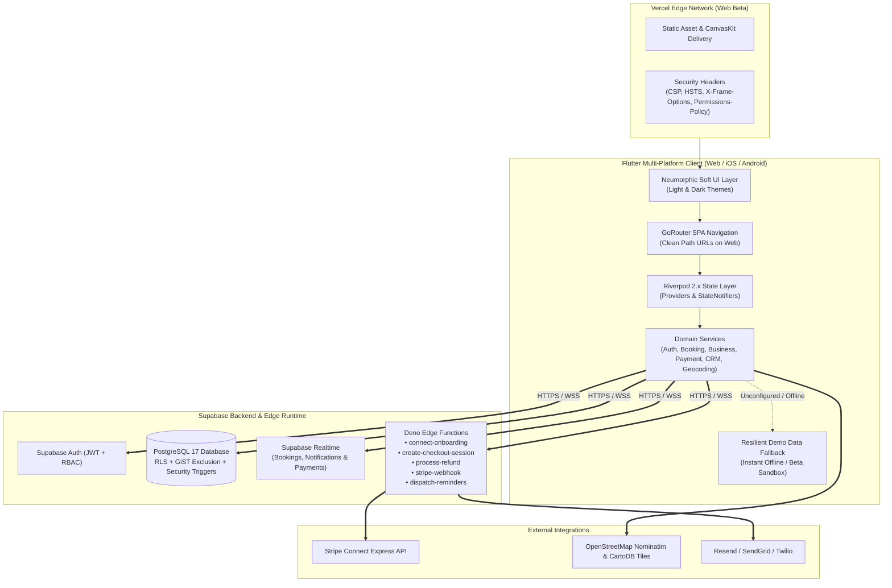

<!-- Gene - Nov, 08, 2026: Comprehensive public GitHub README for BookIt Universal Booking & Clinic Management Platform -->

<div align="center">
  
  <h1>BookIt</h1>
  <p><strong>Universal Multi-Tenant Booking, Live Reception Queue &amp; Clinic CRM Platform</strong></p>

  <p>
    
    
    
    
    
    
  </p>
</div>

---

## Overview

**BookIt** is a full-stack, multi-tenant booking, scheduling, and practice management SaaS platform built with **Flutter** (Web, iOS, Android) and **Supabase (PostgreSQL 17 + Deno Edge Functions)**.

Unlike single-purpose scheduling tools, BookIt provides a **polymorphic booking engine** that adapts its calendar rules, resource allocation, clinical intake forms, and payment policies across **three distinct operational models**:

1. **Slot-Based Appointments (`slot_based`)** — Precision time-slot calculation with turnaround buffers, custom service durations, and practitioner break windows (e.g., *Dental Clinics, Medical Aesthetics, Psychotherapy, Hair & Barber Studios, Legal Consulting*).
2. **Date-Range Stays (`date_range`)** — Multi-night check-in/check-out scheduling with minimum/maximum stay enforcement and suite capacity controls (e.g., *Post-Op Recovery Suites, Wellness Retreats*).
3. **Daily Sessions & Studio Passes (`daily_session`)** — Day-pass or block-session reservations for facilities and equipment (e.g., *Day Spas, Production Studios, Athletic Facilities*).

It runs seamlessly against a **live Supabase + Stripe Connect backend** or out-of-the-box in an **instant in-memory Sandbox / Demo Mode** with pre-seeded clinics, staff rosters, and 1-click persona switching for beta testers.

---

## Key Features

### 1. Client Marketplace & Interactive Map Discovery (`/`)
- **Category & Keyword Filtering:** Browse across 7 core industry verticals (*Healthcare & Clinics, Wellness & Therapy, Beauty & Personal Care, Fitness & Coaching, Professional Consulting, Studios & Space Rentals, Automotive & Detailing*).
- **Interactive OpenStreetMap View:** Toggle between a Neumorphic card grid and an interactive **CartoDB Voyager / Dark Matter** map with custom clinic pins, rating badges, bounding-box auto-fit, and **Locate Me** GPS centering.
- **Clinic Storefront (`/business/:id`):** Hero banners, verified patient reviews, staff bios, transparent service pricing with deposit badges, and 1-tap **Google Maps / Apple Maps** turn-by-turn directions.

### 2. Polymorphic 5-Step Booking Wizard (`/book/:id`)
- **Step 1 — Service & Specialist Selection:** Choose a treatment or recovery tier and optionally assign a specific practitioner.
- **Step 2 — Dynamic Slot / Date-Range Picker:** Real-time availability powered by `SlotCalculator` and server-side PostgreSQL RPCs (`get_available_slots`), respecting clinic working hours, turnaround buffers, and staff lunch breaks.
- **Step 3 — Vertical-Aware Clinical Intake & Contraindication Guard:** Dynamic JSON-configured intake questionnaires (e.g., *Fitzpatrick skin typing, Accutane/pregnancy contraindication blockers, antibiotic pre-medication screening, post-op mobility requirements*).
- **Step 4 — Hybrid Multi-Channel Checkout:**
  - **Stripe Connect Express:** Automated destination charges, platform application fee splitting, and 15-minute reservation holds (`awaiting_payment`).
  - **Direct Clinic Transfers:** Native support for **GCash**, **Maya**, and **Direct Bank Transfer** with reference number and sender account logging.
  - **Flexible Payment Policies:** Supports `full_upfront`, `deposit_required` (percentage or fixed dollar amount), `pay_at_venue`, and `free_consultation`.
- **Step 5 — Digital QR Boarding Pass & Calendar Sync:** Instant confirmation receipt with a scannable **QR Boarding Pass** (`BOOKIT-CHK:<bookingId>`) and 1-tap export to **Google Calendar**, **Apple Calendar**, or RFC-5545 `.ics` download.

### 3. 8-Tab SaaS Admin & Clinic Workspace (`/admin`)
- **Overview & Analytics Tab:** Real-time KPI cards (Gross Revenue, Active Bookings, Completion Rate, Avg Ticket), Peak Hours Bar Chart, Staff Utilization Chart, and Service Revenue Donut Chart.
- **Live Reception Queue Tab:** Real-time waiting room tracker (`Confirmed` → `Arrived / Checked-In` → `In Service` → `Completed`) with live elapsed wait-time badges and a **Camera / USB Barcode QR Check-In Scanner**.
- **Calendar & Walk-In Desk Tab:** Interactive `TableCalendar` with status filters and a **Walk-In Appointment Dialog** that immediately checks in walk-in patients.
- **Patients & Clients CRM Tab:** Automated Lifetime Value (LTV) spend aggregation, VIP/Regular/New/Lapsed segmentation, **Medical Alert Flags** (e.g., *Penicillin Allergy, Latex Sensitivity*), and timestamped **Clinical Staff Dossiers**.
- **Services & Staff Manager Tabs:** Full CRUD for treatments, durations, deposit rules, practitioner profiles, and **7-Day Custom Staff Shift & Break Editors**.
- **Payments, Invoices & Refunds Tab:** Real-time payment ledger with method/reference tracking, **Stripe Connect Express** onboarding, and **Full / Partial Refund** processing.
- **Business Settings & QR Standee Studio Tab:** Clinic profile editor, interactive **OpenStreetMap Geocoding Pin Picker** (with LRU cache and request coalescing), working hours configuration, and a printable **Reception QR Standee Card**.

---

## System Architecture



---

## Defense-in-Depth Security Architecture

BookIt is engineered with multi-layer security controls across the database, serverless functions, and web transport layer:

| Security Layer | Control / Mechanism | Protection Provided |
| :--- | :--- | :--- |
| **Row-Level Security (RLS)** | Enabled on 100% of public tables (`profiles`, `businesses`, `business_staff`, `services`, `bookings`, `payments`, `refunds`, `notifications`, `reviews`, `client_crm_dossiers`, `business_categories`, `business_templates`) | Guarantees strict tenant isolation; business owners can only mutate their own clinics and dossiers. |
| **Privilege Escalation Guard** | `trg_protect_profile_role` (`BEFORE UPDATE ON profiles`) & hardened `handle_new_user` trigger (`SET search_path = public, pg_temp`) | Prevents authenticated users from self-escalating their role to `admin` or hijacking `SECURITY DEFINER` search paths (**CWE-269**, **CWE-426**). |
| **Financial Tampering Guard** | `trg_protect_booking_financial_fields` (`BEFORE UPDATE ON bookings`) + `chk_bookings_non_negative_amounts` | Blocks client-role users from altering `amount_paid`, `amount_due`, `total_price`, or `payment_status`; clients may only transition status to `cancelled` (**CWE-862**). |
| **Concurrency & Double-Booking Prevention** | PostgreSQL `EXCLUDE USING gist` constraint (`no_overlapping_staff_slots`) on `tstzrange(start_time, end_time)` | Prevents race-condition double bookings at the database engine level (**CWE-362**). |
| **Privacy-Safe Availability & CRM RPCs** | `get_busy_slots_for_date` exposes only occupied timestamps (zero client PII); `get_business_crm_profiles` enforces strict owner/admin RBAC inside the RPC and revokes `anon` execute rights | Protects patient privacy and clinical notes from unauthorized enumeration (**CWE-285**, **CWE-359**). |
| **Edge Function Auth & Origin Validation** | Bearer JWT verification + owner RBAC in `connect-onboarding`, `create-checkout-session`, and `process-refund`; `CRON_SECRET` / Service Role guard on `dispatch-reminders`; `isAllowedRedirectUrl` whitelist | Eliminates unauthenticated function abuse, open redirects (**CWE-601**), and notification wallet exhaustion (**CWE-306**). |
| **Webhook Cryptographic Verification** | `stripe.webhooks.constructEventAsync` with `STRIPE_WEBHOOK_SECRET` in `stripe-webhook` | Rejects forged payment webhook payloads (**CWE-345**). |
| **Web Security Headers (`vercel.json`)** | Strict `Content-Security-Policy` (CSP), `Strict-Transport-Security` (HSTS), `X-Frame-Options: DENY`, `X-Content-Type-Options: nosniff`, `Referrer-Policy`, and `Permissions-Policy` | Mitigates XSS, clickjacking, MIME-sniffing, and unauthorized hardware API access. |

---

## Built-In Beta Testing Personas

When testing on Vercel Web or locally, click the **Switch Demo Persona** icon (`Icons.switch_account_outlined`) in the top navigation bar at any time to switch between pre-configured roles and clinics without needing external credentials:

| Persona | Role | Default Clinic / Context |
| :--- | :--- | :--- |
| **Dr. Alexander Vance** | `business_owner` | **Apex Dental & Orthodontic Care** + **Lumina Aesthetic & Dermatology Center** |
| **Elena Rostova** | `business_owner` | **Serenity Post-Op Recovery & Wellness Suites** (`date_range` model) |
| **Marcus Sterling** | `business_owner` | **Vanguard Barber & Grooming Lounge** + **IronCore Private Coaching** + **Apex Auto Detailing** |
| **Michael Chen** | `client` | Patient account with upcoming & past bookings, QR passes, and CRM history |
| **Dr. Sophia Martinez** | `staff` | Periodontics & Implants specialist view |

You can also click **"Reset All Demo Data to Default"** inside the Persona Switcher dialog to restore all in-memory bookings, queues, payments, and reviews to their clean initial state.

---

## Getting Started (Local Development)

### Prerequisites
- **Flutter SDK:** `>= 3.22.0` (Dart `>= 3.13.0`)
- **Supabase CLI** *(optional, for local DB/Edge Functions)*

### 1. Clone & Install Dependencies
```bash
git clone https://github.com/<your-username>/bookit.git
cd bookit
flutter pub get
```

### 2. Configure Environment Variables (Optional)
BookIt runs immediately in **Sandbox / Demo Mode** without any external keys. To connect to your own Supabase project:
```bash
cp .env.example .env
# Edit .env with your SUPABASE_URL and SUPABASE_ANON_KEY
```

### 3. Run the Application
```bash
# Run on Chrome (Web Beta)
flutter run -d chrome \
  --dart-define=SUPABASE_URL=https://your-project.supabase.co \
  --dart-define=SUPABASE_ANON_KEY=your-anon-key

# Run on iOS / Android Simulator
flutter run
```

### 4. Run Static Analysis & Automated Test Suite
```bash
flutter analyze
flutter test
```

---

## Deploying Web Beta to Vercel

This repository is pre-configured for **Vercel** via [`vercel.json`](vercel.json) and [`scripts/vercel_build.sh`](scripts/vercel_build.sh).

### Option A: Automatic Git Deployment (Recommended)
1. Push this repository to GitHub and import it into **[Vercel](https://vercel.com/new)**.
2. Vercel automatically detects [`vercel.json`](vercel.json):
   - **Build Command:** `bash scripts/vercel_build.sh`
   - **Output Directory:** `build/web`
3. *(Optional)* In **Vercel Project Settings → Environment Variables**, add:
   - `SUPABASE_URL` — Your Supabase Project URL (`https://<project-ref>.supabase.co`)
   - `SUPABASE_ANON_KEY` — Your Supabase publishable `anon` key
   - `FORCE_MOCK_MODE` — Set to `true` if you want the public beta URL to run strictly in isolated in-memory demo mode.
4. Click **Deploy**. SPA deep links (`/admin`, `/my-bookings`, `/business/:id`), security headers, and cache rules are applied automatically.

### Option B: Fast Pre-Built Deploy via Vercel CLI
If you already built the web bundle locally (`flutter build web --release`), you can deploy directly:
```bash
# 1. Build Flutter Web release bundle
flutter build web --release

# 2. Deploy to Vercel Preview (Beta URL)
vercel deploy

# 3. Promote to Production when ready
vercel deploy --prod
```

---

## Supabase Database & Edge Functions Setup

### 1. Database Schema & RLS Bootstrap
To initialize a fresh Supabase project with all tables, Row-Level Security policies, security triggers, GiST exclusion constraints, RPCs, and starter vertical templates in one step:
1. Open the **Supabase Dashboard → SQL Editor**.
2. Paste and execute [`supabase/master_setup.sql`](supabase/master_setup.sql).
   *(Alternatively, run `supabase db push` via the Supabase CLI to apply all migrations in [`supabase/migrations/`](supabase/migrations/)).*

### 2. Deploy Supabase Edge Functions
```bash
supabase functions deploy connect-onboarding
supabase functions deploy create-checkout-session
supabase functions deploy process-refund
supabase functions deploy stripe-webhook --no-verify-jwt
supabase functions deploy dispatch-reminders

# Configure Edge Function secrets
supabase secrets set \
  STRIPE_SECRET_KEY=sk_test_... \
  STRIPE_WEBHOOK_SECRET=whsec_... \
  ALLOWED_ORIGIN=https://your-bookit-beta.vercel.app \
  CRON_SECRET=your-random-cron-secret
```

---

## Project Structure

```text
bookit/
├── assets/
│   └── logo/                        # BookIt geometric 'B' + Checkmark SVG & PNG brand assets
├── lib/
│   ├── core/
│   │   ├── constants/               # SupabaseConfig, DemoData seed fixtures, test environment detector
│   │   ├── router/                  # GoRouter configuration (clean path URLs + universal routes)
│   │   ├── theme/                   # Neumorphic Light & Dark themes, colors, and ThemeMode provider
│   │   ├── utils/                   # PaginatedResult, AppErrorLogger ring buffer
│   │   └── widgets/                 # NeumorphicContainer, NeumorphicButton, BookItLogo, DemoPersonaSwitcher
│   ├── features/
│   │   ├── admin/                   # 8-tab SaaS Admin Workspace, Onboarding Wizard, QR Scanner, Standee Studio
│   │   ├── auth/                    # Login, Signup, and Profile screens
│   │   ├── booking_engine/          # 5-step Universal Booking Wizard & SlotCalculator engine
│   │   ├── client_bookings/         # Client reservations, QR Boarding Pass modal, Reschedule & Review dialogs
│   │   ├── discovery/               # Marketplace Home, OpenStreetMap Discovery View, Business Detail storefront
│   │   └── notifications/           # Real-time notification feed & unread badge counter
│   ├── models/                      # Immutable domain models (Business, Booking, ServiceItem, Payment, CRM, etc.)
│   ├── services/                    # SupabaseService, AuthService, BookingService, PaymentService, CrmService, etc.
│   └── main.dart                    # Application entrypoint with usePathUrlStrategy() & ProviderScope
├── scripts/
│   └── vercel_build.sh              # Automated Flutter Web build script for Vercel CI/CD
├── supabase/
│   ├── functions/                   # Deno TypeScript Edge Functions (Stripe Connect, Checkout, Refunds, Reminders)
│   ├── migrations/                  # Ordered PostgreSQL schema, RLS, RPC, and security hardening migrations
│   └── master_setup.sql             # Consolidated idempotent SQL setup script
├── test/                            # 175+ unit, widget, security, and full-lifecycle integration tests
├── web/                             # Flutter Web shell, Neumorphic boot splash, PWA manifest, and icons
├── .env.example                     # Sanitized environment variable template
└── vercel.json                      # Vercel SPA routing rewrites, CSP/HSTS security headers, and cache policies
```

---

## License

This project is released for public demonstration, beta testing, and educational reference.

<!--
Gene - Nov, 08, 2026: Preserved original Flutter starter README boilerplate per Code Modification & Deprecation Policy
# bookit

A new Flutter project.

## Getting Started

This project is a starting point for a Flutter application.

A few resources to get you started if this is your first Flutter project:

- [Learn Flutter](https://docs.flutter.dev/get-started/learn-flutter)
- [Write your first Flutter app](https://docs.flutter.dev/get-started/codelab)
- [Flutter learning resources](https://docs.flutter.dev/reference/learning-resources)

For help getting started with Flutter development, view the
[online documentation](https://docs.flutter.dev/), which offers tutorials,
samples, guidance on mobile development, and a full API reference.
-->
